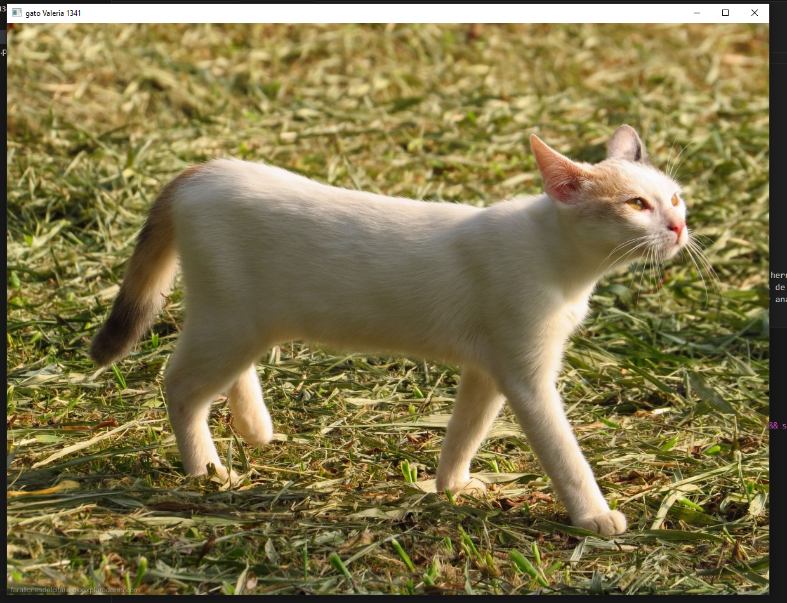
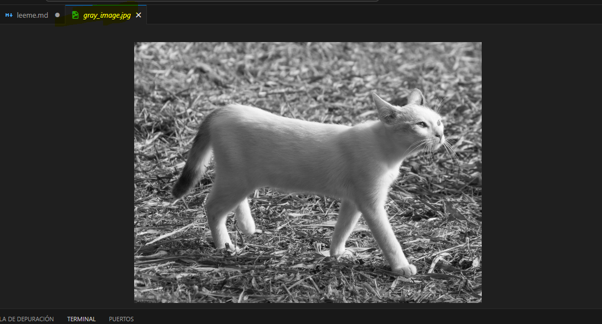
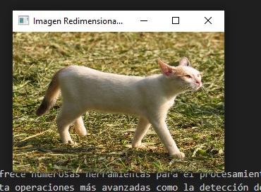
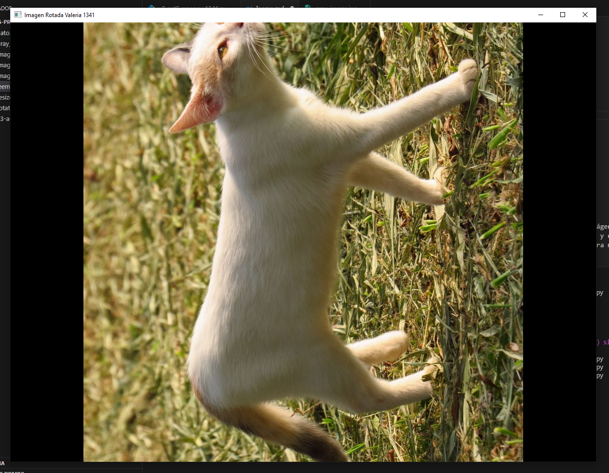
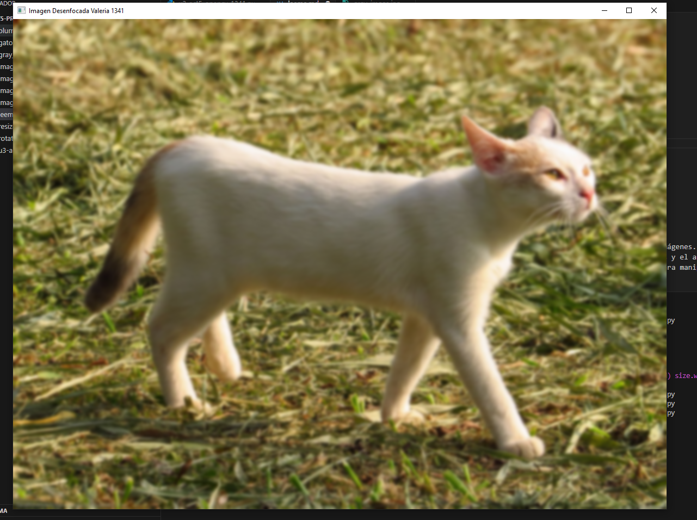
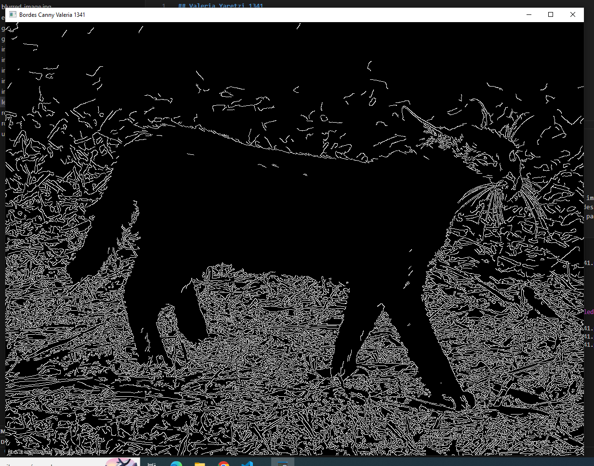
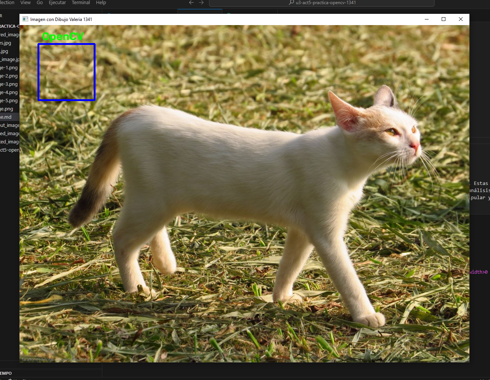
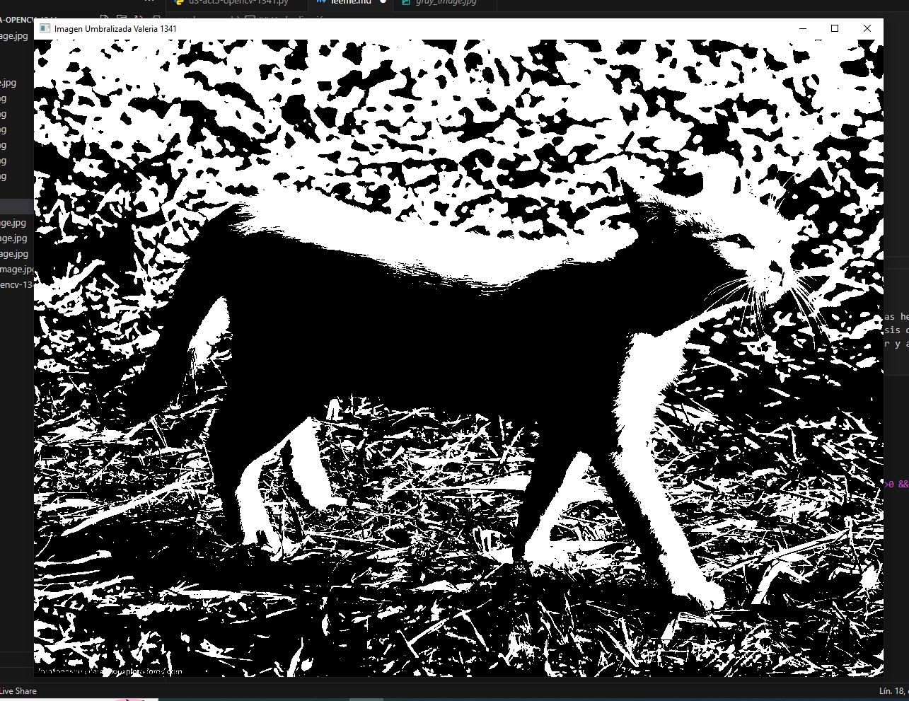
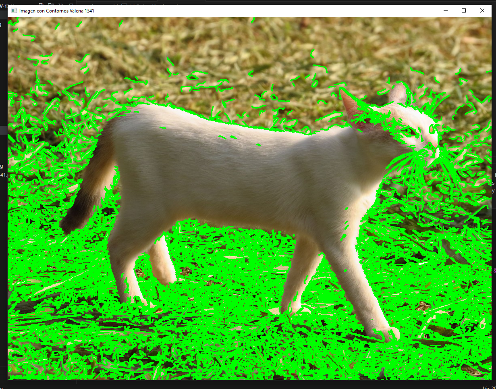

## Valeria Yaretzi 1341
## Practica opencv
##  Lectura y visualización de imágenes

## Conversión entre espacios de color

## Cambiar el tamaño de una imagen

## Rotar una imagen

## Desenfoque de una imagen

## Detección de bordes mediante el algoritmo de Canny

## Dibujar formas y añadir texto

## Umbralización

## Detección de contornos

## Conclusión
- OpenCV es una biblioteca increíblemente versátil que ofrece numerosas herramientas para el procesamiento de imágenes. Estas herramientas abarcan desde tareas básicas como el redimensionamiento y la rotación de imágenes hasta operaciones más avanzadas como la detección de bordes y el análisis de contornos. Tanto si estás creando un modelo de IA como si simplemente explorando la visión artificial, OpenCV debería ser tu herramienta principal para manipular y analizar imágenes.